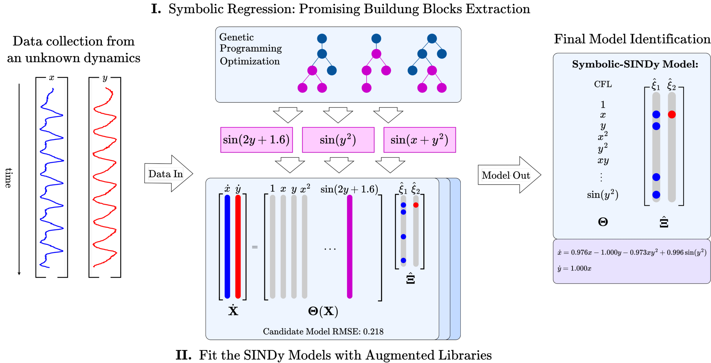

# Symbolic-SINDy: Data-Driven Model Discovery

This repository contains the code developed for the Master's thesis: **[Data-driven discovery of dynamical systems through Symbolic-SINDy](https://www.politesi.polimi.it/handle/10589/251217)**

The work investigates how the synergy between **Symbolic Regression (SR)** and **Sparse Identification of Nonlinear Dynamics (SINDy)** can provide an effective approach to challenging model discovery tasks. By combining the complementary strengths of these two methodologies, Symbolic-SINDy aims to overcome some of their individual limitations, improving model discovery capabilities while maintaining computational efficiency and reducing the need for prior knowledge.

## Symbolic-SINDy Framework

## Abstract

The process of distilling parsimonious closed-form models directly from measurements of a system is known as (Data-driven) Model Discovery. While Symbolic Regression and Sparse Identification of Nonlinear Dynamics (SINDy) have emerged as leading methodologies, they often suffer, respectively, from high computational costs and the requirement of prior knowledge, limiting their applicability when faced with more challenging tasks.

Symbolic-SINDy is a promising framework that bridges these two algorithms, taking advantage of their complementary strengths and overcoming their respective practical limitations. Indeed, through their synergy, it is possible to increase user independence while preserving computational and time efficiency.

This work consolidates and extends the Symbolic-SINDy framework in different scenarios. First, the method proves its effectiveness with respect to complex dynamical systems, where both Symbolic Regression and SINDy struggle with the model discovery scope. Subsequently, Symbolic-SINDy is combined with a change-point detection algorithm to address online learning problems. The proposed implementation demonstrates its flexibility in adapting the discovered model to abrupt changes in the underlying dynamics over time. Finally, the framework is integrated with a convolutional autoencoder to perform model discovery within a latent space. The achieved results demonstrate that Symbolic-SINDy effectively identifies latent dynamics consistent with high-dimensional behavior, proving to be a powerful tool for Reduced Order Modeling (ROM).
